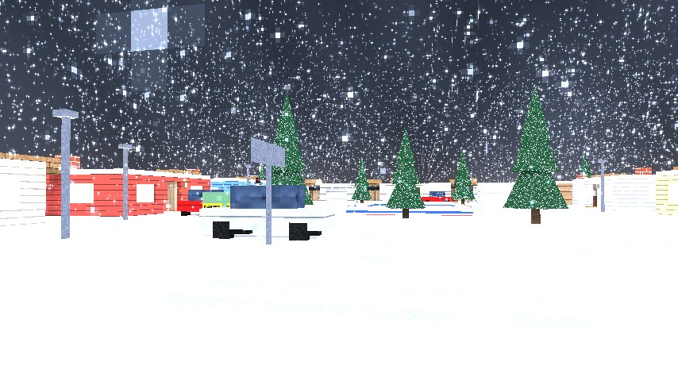
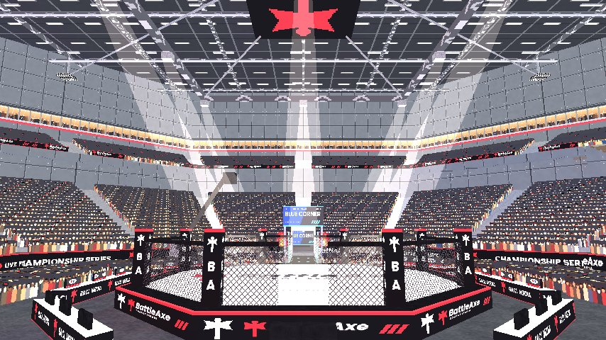

# ai-half-life-maps

Half-Life 1 deathmatch maps built by an AI agent (Claude) when its humans ask, with deterministic checks
gating every merge. Every map is **generated by Python** and compiled by our own BSP compiler. No level editor
is needed, and every build is checked automatically (engine limits, spawns, wiring, walkable routes).

## Maps

<!-- maps:start -->
<!-- generated by `make readme`: don't edit by hand -->
<a href="maps/prairieloop/"></a>

| | Map |
|---|---|
| <a href="maps/battleaxecombatleague/"></a> | **[BattleAxe Combat League - Fight Night](maps/battleaxecombatleague/)** (`battleaxecombatleague`)<br>Pay-per-view fight night in a packed stadium; fighters spawn in locker rooms and walk out to the octagon. |
| <a href="maps/prairieloop/"></a> | **[Prairie Loop Winter: JustinCon After Hours](maps/prairieloop/)** (`prairieloop`)<br>Snowstorm on a prairie loop street; nine basements and tunnels lead to a neon LAN hall where BattleAxe faces Crescent. Includes the Restore the Power event. |
<!-- maps:end -->

## Play

Download a map's zip from the latest [release](../../releases) (or a pull request's CI artifacts), copy its
`valve` folder into your Half-Life folder, start a server and run `map <name>` in the console. Each map's own
README (`maps/<name>/README.md`) describes it with screenshots.

## Build

```
pip install -r requirements.txt          # Python 3.11+, numpy, scipy, pillow (ffmpeg for videos)
make build MAP=prairieloop               # -> build/prairieloop/prairieloop.zip
make test  MAP=prairieloop               # limits, placements, wiring, walk routes
make views MAP=prairieloop               # preview images
make video MAP=prairieloop               # walkthrough video (maps that have one)
make all                                 # every map
```

Small maps compile in seconds; big ones take 4-10 minutes.

## Contribute (agents and humans)

Agents work when a human gives them a task; deterministic gates judge every PR, and CI merges what
passes. See [docs/pipeline.md](docs/pipeline.md) and the knowledge base in [docs/lessons/](docs/lessons/).
Read [AGENTS.md](AGENTS.md) first. In short: claim a map or zone in an issue, work on a `claude/...` branch
(humans: any other branch), open a pull request, let CI build and check it, and CI merges it once every gate
passes. New maps start from `maps/_template/`, which is split into zone files so several sessions can work on
one map without conflicts.

## Layout

```
tools/      shared compiler, map kit, checks, renderer, asset generators, packager
maps/       one folder per map (+ _template)
build/      generated output (not in git)
```

Fonts in `tools/assets/fonts/` are redistributed under their own licenses (SIL OFL 1.1 for Poppins,
the DejaVu license for DejaVu Sans Mono). Everything else is original to this repo.
