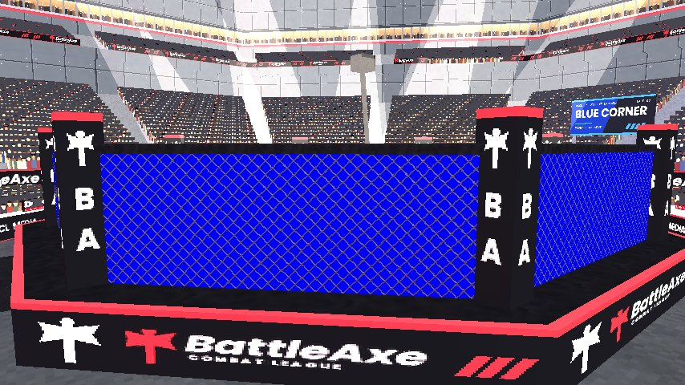
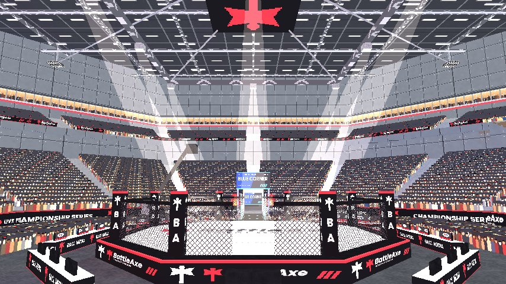
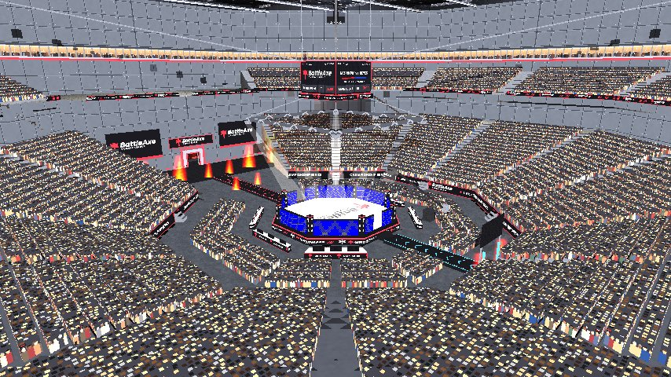
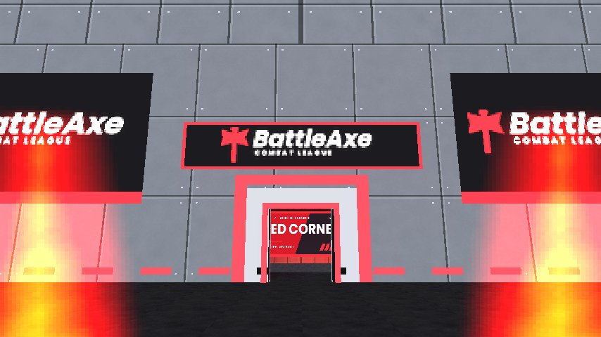
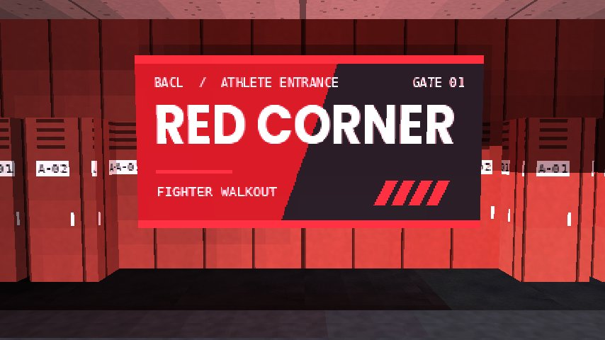
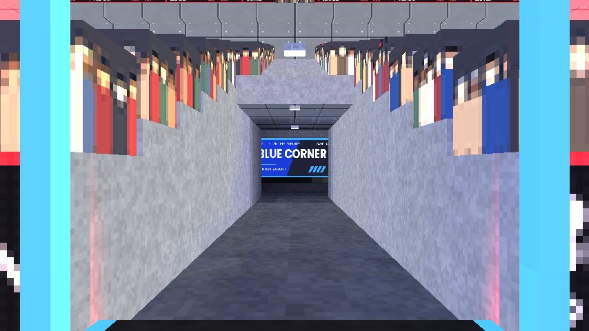
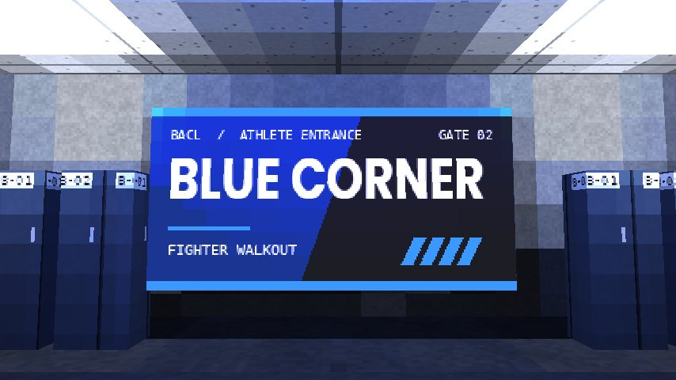
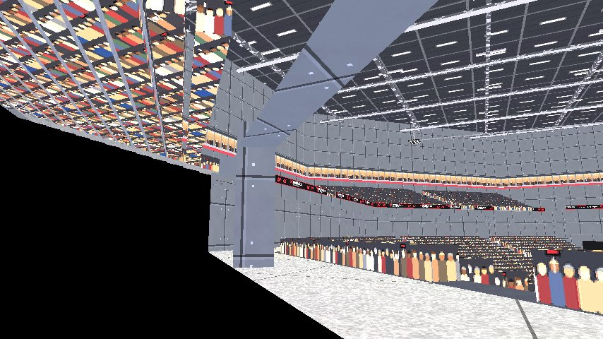
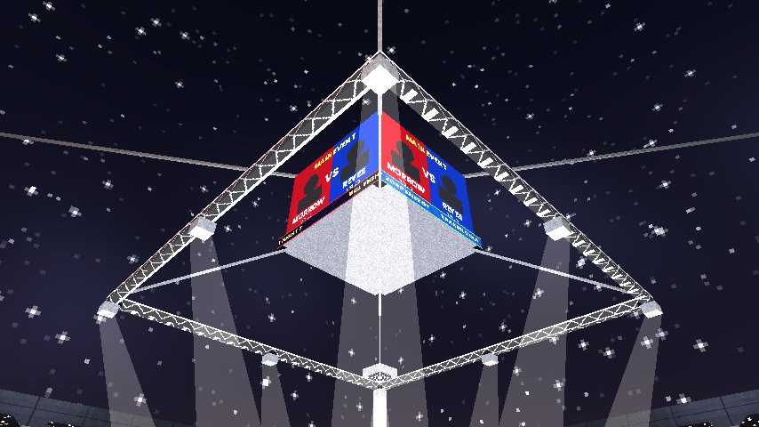

# BattleAxe Combat League - Fight Night

A pay-per-view fight night in a packed stadium at night (a fictional promotion with invented fighters and
sponsors).

- **The walkout:** every player spawns in a locker room and walks to the cage.
  - Red corner: locker room behind the LED wall -> pyro stage -> runway.
  - Blue corner: locker room under the north stands -> tunnel -> arena floor.
- **The octagon:** raised cage with a see-through fence, padded posts, a BCL logo canvas, and a gate on
  each side. Most weapons are inside.
- **The stadium:** lighting truss with spotlight beams, centre-hung jumbotron on cables from four light
  towers, press row, broadcast desk, camera crane, floor seats, lower bowl, concourse, and an upper deck
  reached by four corner stairways. The crowd is decoration (you can walk through it).

Console: `map battleaxecombatleague`

## Build it

```
make build MAP=battleaxecombatleague && make test MAP=battleaxecombatleague
```
The playable zip lands in `build/battleaxecombatleague/battleaxecombatleague.zip`.

<!-- screenshots:start -->
<!-- generated by `make readme`: don't edit by hand -->
## Screenshots

Rendered by CI from `main` after every release (preview renderer: see-through fences show as solid blue).

| | |
|---|---|
| <br>`cage` | <br>`stadium` |
| <br>`upperdeck` | <br>`walkout` |
| <br>`redroom` | <br>`bluetunnel` |
| <br>`blueroom` | <br>`stairs` |
| <br>`jumbotron` |  |
<!-- screenshots:end -->
