# Casa Roble: Spanish Bungalow Under the Oaks

A one-storey 1920s Spanish-style bungalow on a quiet hillside street in the late-afternoon sun: cream stucco,
a flat roof behind a clay-tile parapet, copper downspouts, a low-water gravel garden out front, an oak-shaded
deck out back and a detached one-car garage, half converted to an office, at the end of a long driveway.
Small and close-quarters: about 14 players.

## Layout

The street is south, the backyard north. Zones (one file each in `zones/`):

| Zone | Where | What's there |
|---|---|---|
| `street` | y -400..256 | Road with a parked car (cover), sidewalk and street lamp, gravel garden with agave planters, tiled entry porch with two 8-unit steps |
| `house` | x -480..272, y 256..1216 | Living room with a wood-burning fireplace; dining; kitchen with breakfast bar and skylight; hall to bedrooms 2 and 3 and the hall bath; primary bedroom with its own bath; family room. Breakable windows everywhere; sliders from the primary and the family room onto the deck. Side yard along the west wall |
| `backyard` | x -480..272, y 1216..1856 | Deck flush with the house floor (one step down to the lawn), outdoor table, four oaks |
| `garage` | x 272..480, y 256..1856 | Driveway along the east side; garage with a raised roll-up door, shelving and boxes, and an office behind a partition. Side door to the backyard |
| `shell` | everything | Sky box and the sun |

Floors: ground z = 0, house and deck z = 16, road z = -6. House ceiling z = 176, garage ceiling z = 144.

## Weapons

Strong weapons sit in exposed or dead-end spots, away from spawns: the RPG in the garage office (a dead end),
the crossbow out on the open deck, the 357 just inside the primary bedroom door, the shotgun by the dining
table and the MP5 in the kitchen. Satchels on the back lawn, grenades in the front garden.

<!-- screenshots:start -->
<!-- generated by `make readme`: don't edit by hand -->
## Screenshots

Rendered by CI from `main` after every release.

| | |
|---|---|
| 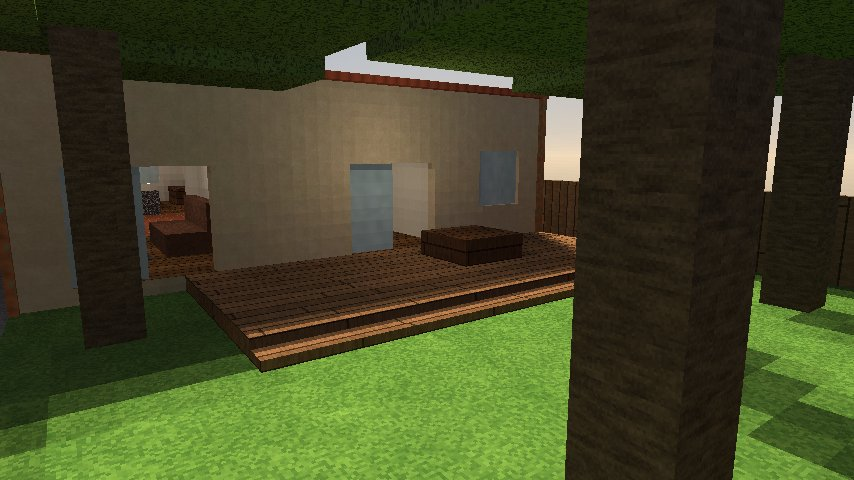 `deck_under_the_oaks` | 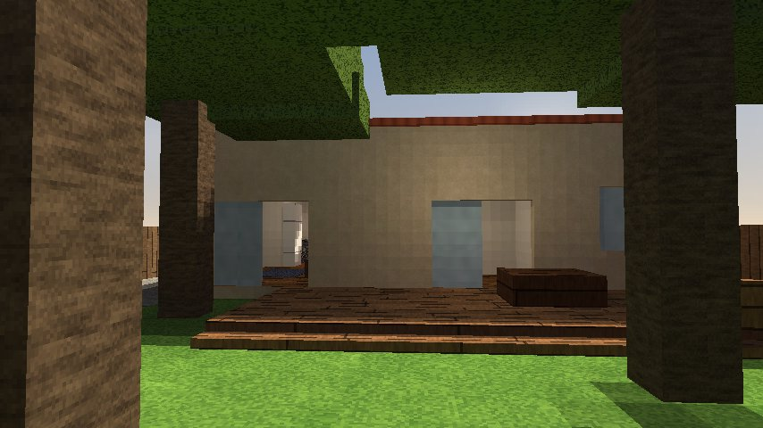 `back_of_house` |
| 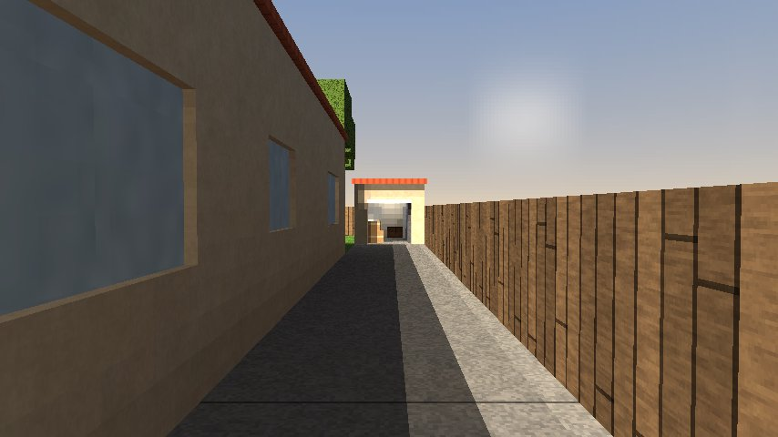 `driveway_to_garage` | 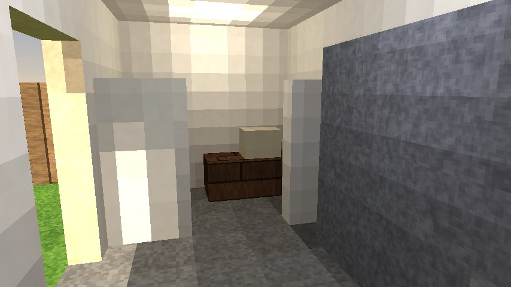 `garage_office` |
| 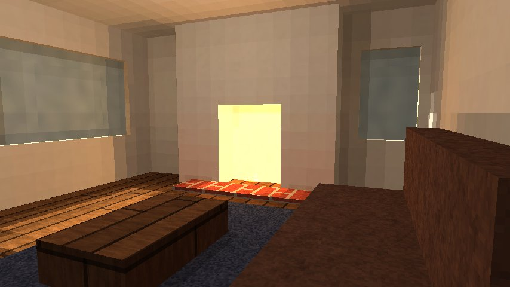 `living_fireplace` | 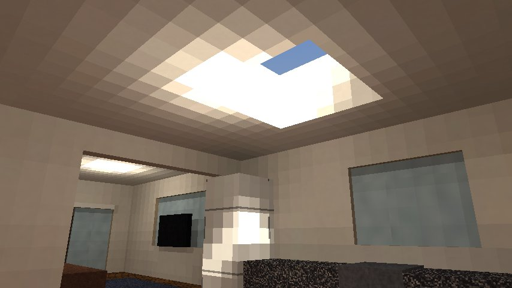 `kitchen_skylight` |
| 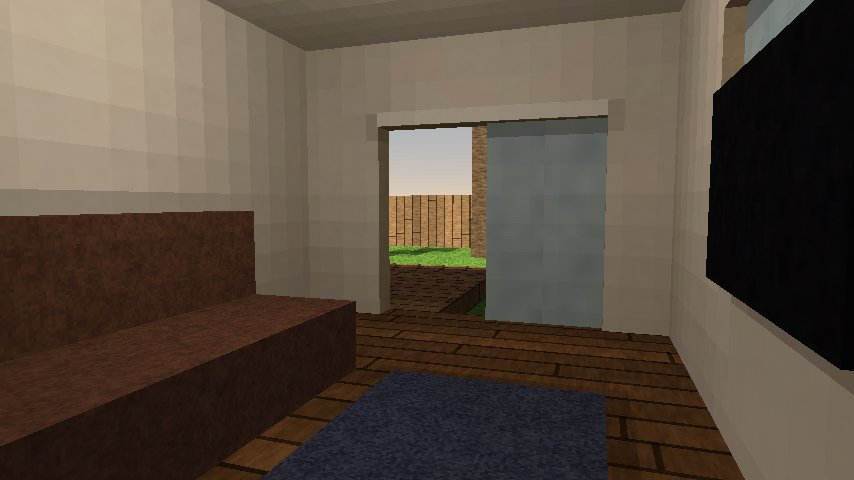 `family_room_to_deck` | 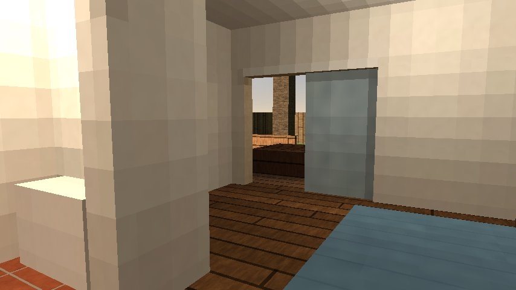 `primary_bedroom` |
| 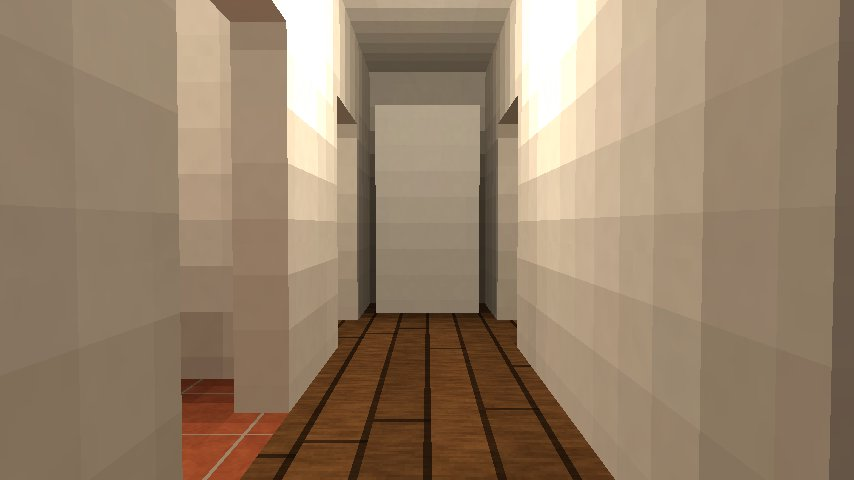 `hall` | 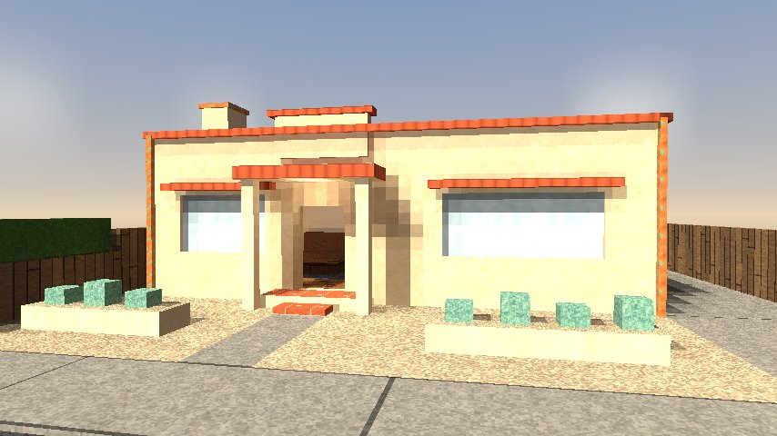 `front_from_street` |
| 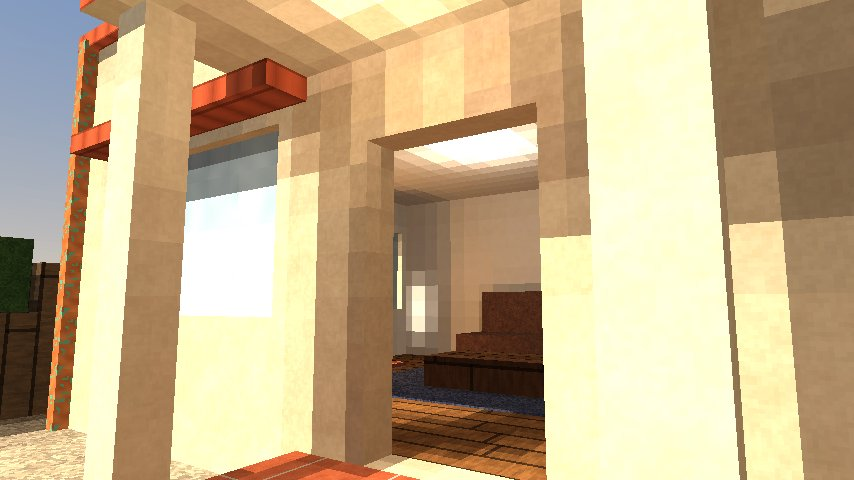 `front_porch` |  |
<!-- screenshots:end -->
