# Prairie Loop Winter: JustinCon After Hours

A quiet prairie neighbourhood in a snowstorm. Under the houses, nine basements connect to JustinCon, a
32-PC neon LAN hall where BattleAxe faces Crescent.

## Above ground
- Nine houses around a loop road, a long street running west into the storm, a skating rink in the park,
  and a snowman in a top hat outside the blue house.
- Snow falls constantly and blows sideways in gusts; heavy bursts sweep the far (west) end of the street.
  Wind is heard outdoors and fades into computer-fan hum underground.
- Playable rooftops: exterior stairs (NW house, east house), a walkable snowbank (SW house), and short
  bridges that join every roof on both rows, the two garages and the east house.

## Below ground
- Every house has an interior and a basement. A loop tunnel under the road joins all nine.
  West half = BattleAxe (pink/coral), east half = Crescent (cyan/violet).
- The blue house: stairs down to a small computer room, then a second staircase under the tunnel that opens
  onto a balcony above JustinCon.
- JustinCon: 8 pods x 4 CRT workstations, arcade carpet, glowing wall strips, a stage under the neon sign
  with the BattleAxe vs Crescent match board. Invented player handles on individual CRTs: FragTaco, PixelMoose, LagWizard, SnowCrab, QuadToast, NullHornet,
  ByteKnight, CampKing, RocketRita, GibMaster, Wavedash, MidnightMod.

## Restore the Power (interactive event)
Three breaker switches: inside the north garage (smash the garage door first), on the south side of the
loop tunnel, and on a pole at the far west end of the street. Flip all three and everyone sees
"POWER RESTORED", the park transformer explodes, the screen shakes, an alarm sounds, and the JustinCon
server-room door opens for a while. Inside: an ARMORY button that gives every weapon. It can happen again
after 45 seconds.

Also: breakable garage door and crates, a steam-vent updraft (jump in) behind a south-row house, a teleport
pad on the stage to the blue house roof, spinning ceiling fans, chasing-light marquees, a health charger in
the BattleAxe tunnel and an armor charger in the Crescent tunnel.

Console: `map prairieloop`

## Layout notes for agents
- Ground `z = 0`; basements and tunnels floor `-176`; the hall floor `-464`; roofs `144`.
- Loop road between the park `(+-896, +-448)` and `(+-1152, +-704)`; houses at `y = +-1056`; west street to `x = -3072`.
- `tests/routes.py` lists every route that must stay walkable.

## Build it

```
make build MAP=prairieloop && make test MAP=prairieloop
make video MAP=prairieloop     # walkthrough video (about 20 minutes on 2 cores)
```
The playable zip lands in `build/prairieloop/prairieloop.zip`.

<!-- screenshots:start -->
<!-- generated by `make readme`: don't edit by hand -->
## Screenshots

Rendered by CI from `main` after every release.

| | |
|---|---|
| 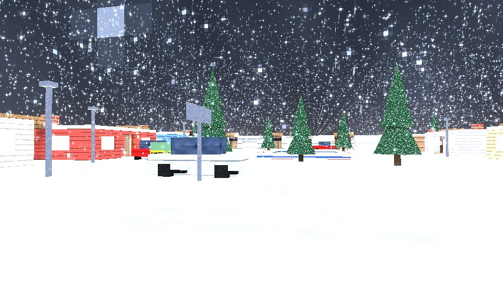<br>`street` | 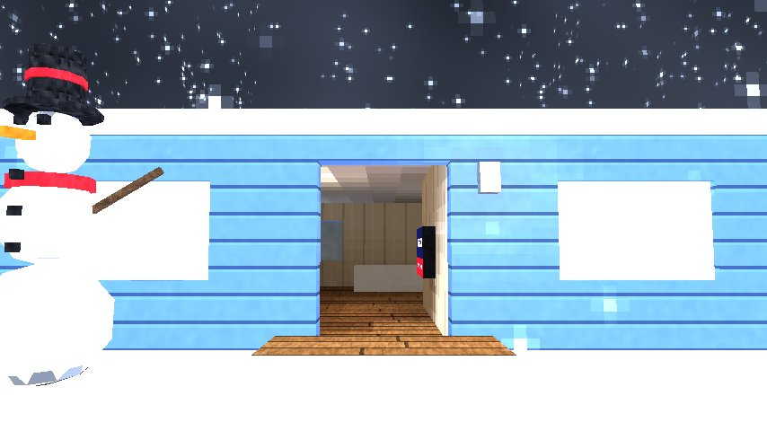<br>`bluehouse` |
| 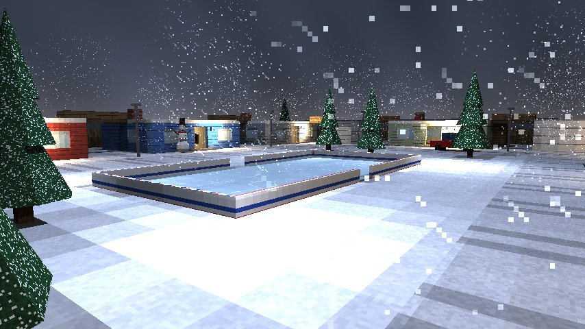<br>`rink` | 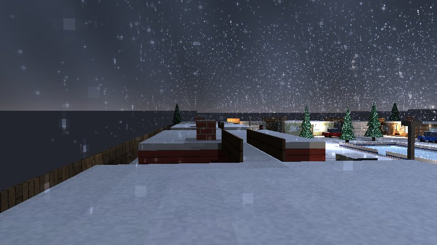<br>`roofs` |
| 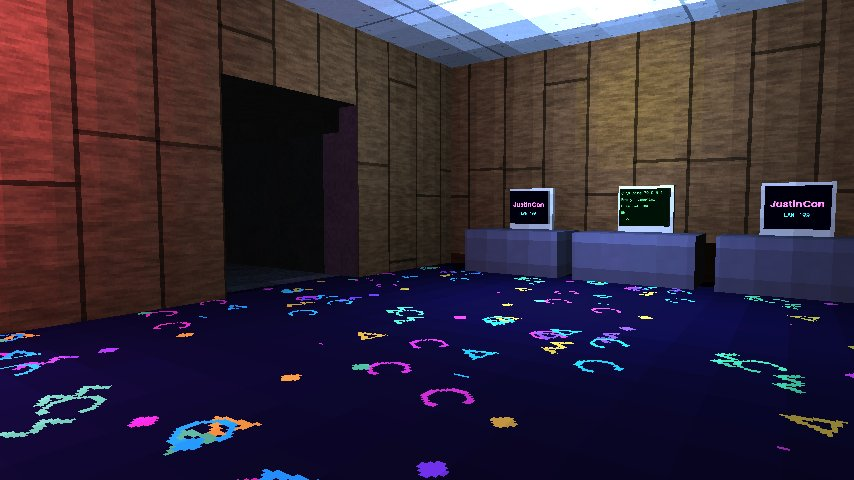<br>`compRoom` | 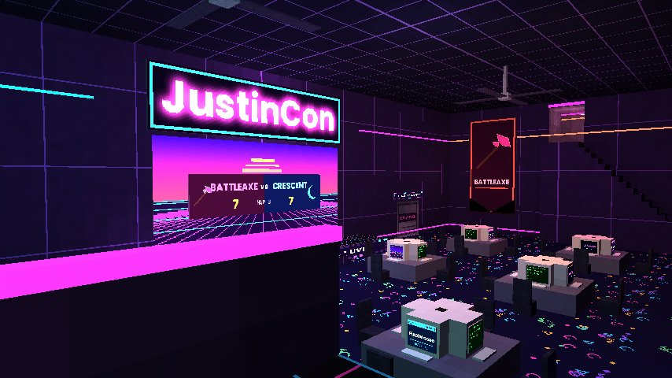<br>`reveal` |
| 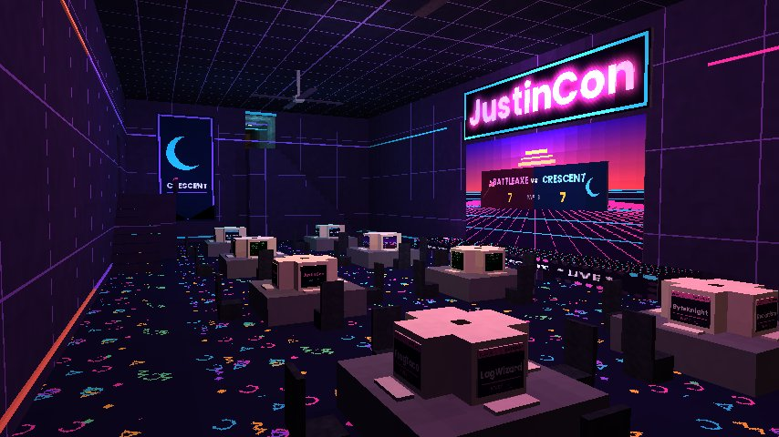<br>`hall` | 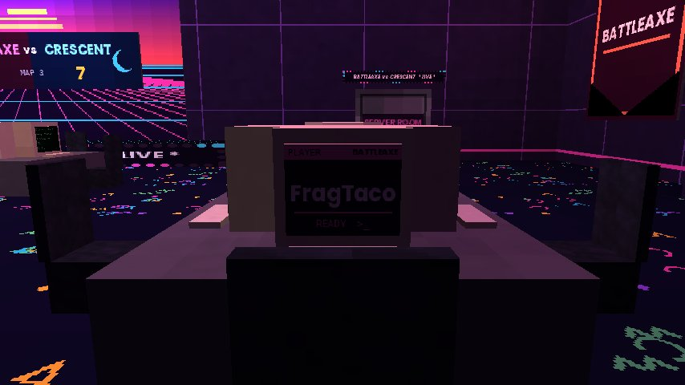<br>`handles` |
| 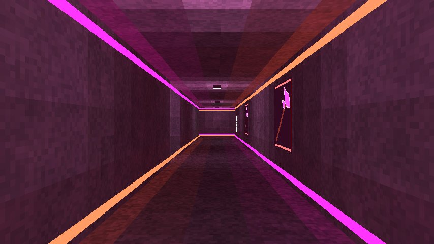<br>`axeTunnel` | 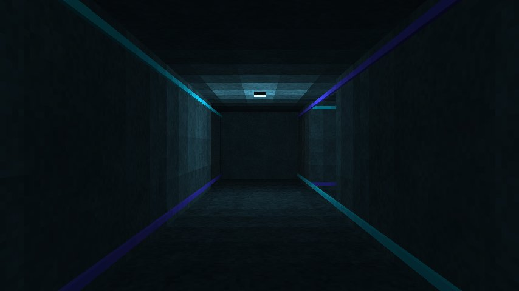<br>`moonTunnel` |
| 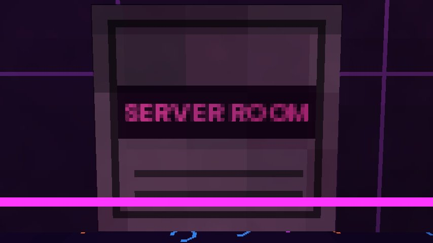<br>`serverroom` | 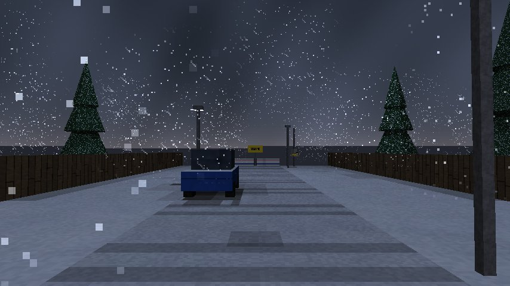<br>`farend` |
| 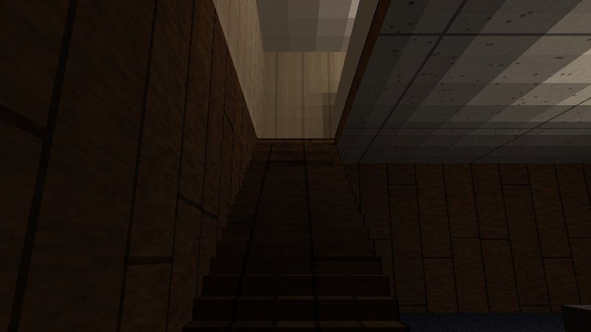<br>`basementStairs` | 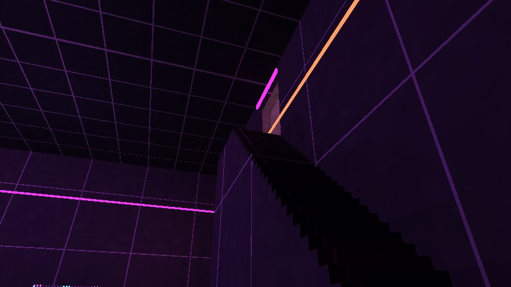<br>`hallStairs` |
| 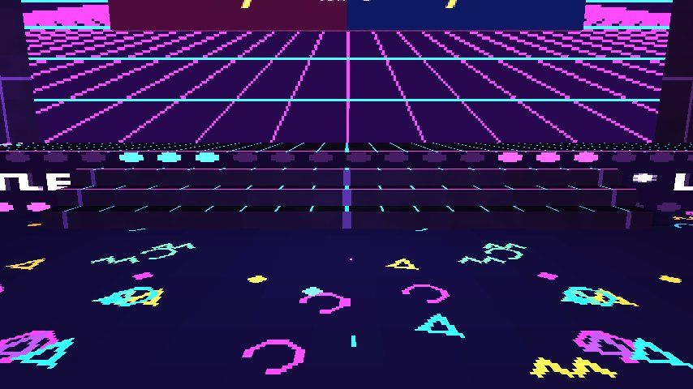<br>`stageSteps` | 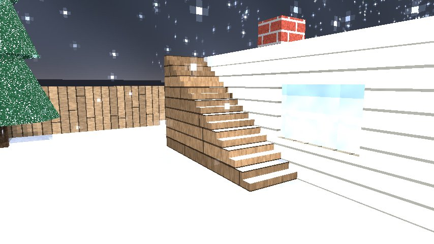<br>`roofStairs` |
<!-- screenshots:end -->
